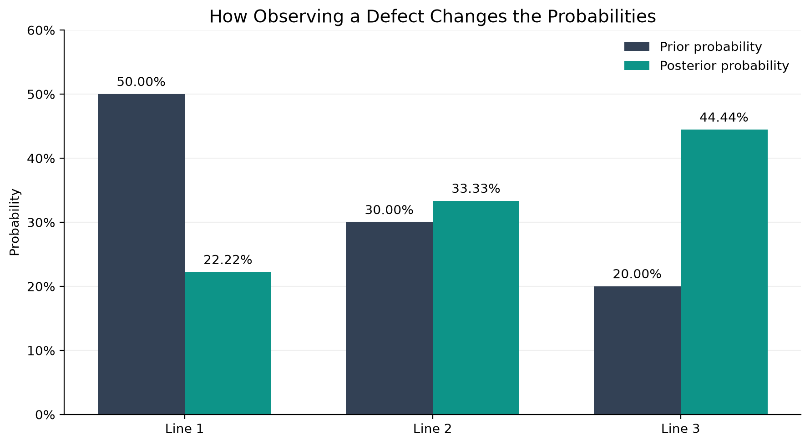

# Bayes' Theorem Playground

An interactive Python project that explores how new evidence changes probabilities using Bayes' Theorem.

The project combines mathematical calculations, Monte Carlo simulation, and an interactive Streamlit application.

## The Problem

Imagine a factory with three production lines. Each line produces a different proportion of products and has its own defect rate.

| Production Line | Production Share | Defect Rate |
|---|---|---|
| Line 1 | 50% | 2% |
| Line 2 | 30% | 5% |
| Line 3 | 20% | 10% |

Suppose we randomly select a product and discover that it is defective.

**What is the probability that it came from Line 3?**

Using Bayes' Theorem, we can calculate the probability of each production line being the source of a defective product.

For Line 3, the result is approximately **44.44%**.

Although Line 3 produces only 20% of all products, it accounts for approximately 44.44% of defective products.



## What You Can Explore

The Streamlit application allows you to:

1. Change the production proportions of the three lines.
2. Adjust the defect probability of each line.
3. Calculate theoretical probabilities using Bayes' Theorem.
4. Run a Monte Carlo simulation with a customizable number of products.
5. Compare theoretical and simulated results.
6. Visualize how prior probabilities change after observing a defect.

The simulation uses a configurable random seed so results can be reproduced with the same settings.

## Running the Project Locally

First, create a Python virtual environment:

```bash
python -m venv .venv
```

Activate the environment.

On Windows PowerShell:

```powershell
.\.venv\Scripts\Activate.ps1
```

On macOS or Linux:

```bash
source .venv/bin/activate
```

Install the required packages:

```bash
python -m pip install -r requirements.txt
```

Start the Streamlit application:

```bash
python -m streamlit run app.py
```

The application will open in your browser, usually at `http://localhost:8501`.

You can also run the mathematical calculations and simulation separately:

```bash
python bayes.py
python simulation.py
```

## Project Structure

```text
bayes_theorem_playground/
    app.py
    bayes.py
    simulation.py
    visualize.py
    requirements.txt
    README.md
    images/
        prior_vs_posterior.png
```

## Assumptions

The example assumes that every product comes from exactly one production line, production proportions sum to 100%, and defect rates remain constant.

The simulation generates products independently using the specified probabilities.

Because the simulation uses random sampling, its estimates may differ slightly from the theoretical results.

## Technologies

Python, NumPy, Matplotlib, and Streamlit.